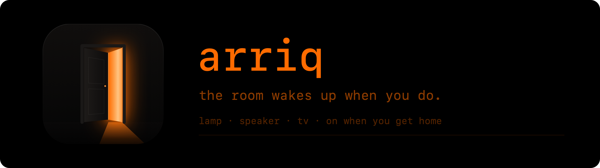
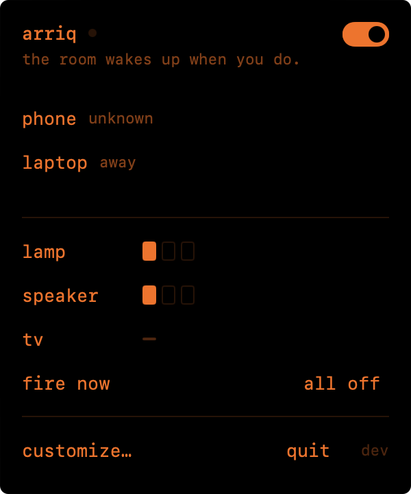
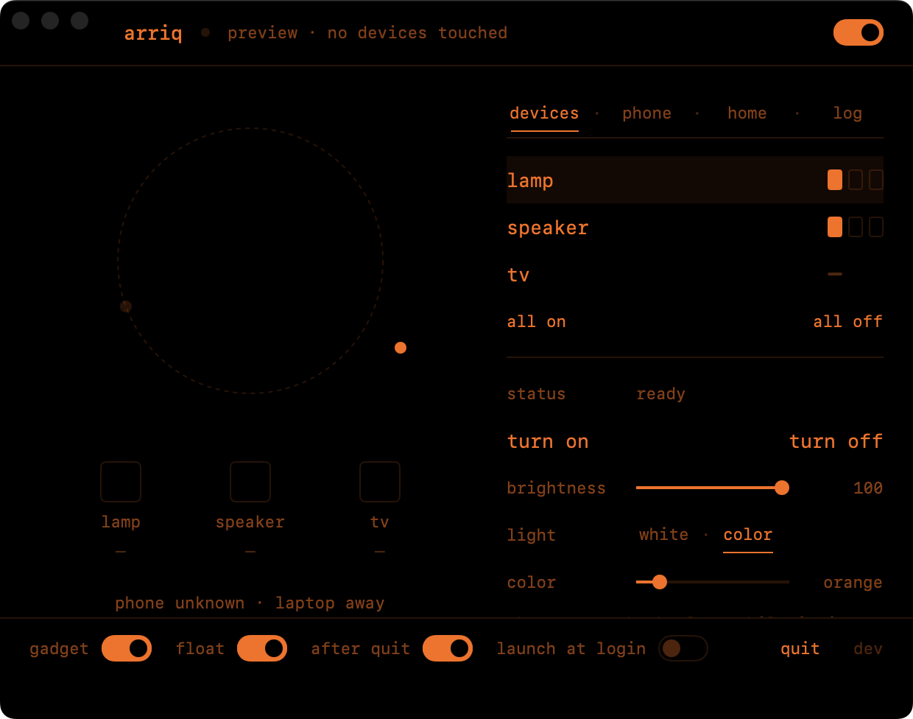

<p align="center">
  
</p>

<p align="center">
  <b>walk in. the lamp is on, the speaker is playing, the tv is up.</b><br>
  a small macos menu bar app that sets up your room the moment you get home.
</p>

<p align="center">
  macos 13+ · menu bar · free · mit license
</p>

---

## how it feels

you leave work. your phone notices when you reach home and quietly tells arriq. your mac is already on the home
wi-fi, so arriq knows it is really you, and the room comes on in sequence: the lamp first, then the speaker, then
the tv. no app to open, nothing to tap.

<p align="center">
  
</p>

## what you can do

| | |
|---|---|
| **arrive home** | lamp, speaker and tv switch on by themselves, each after its own delay. |
| **turn anything on or off** | click a device square, or use `all on` / `all off`. off also works while arriq is paused. |
| **set the light** | brightness, and either warm white (2000–9000k) or a colour. changes reach the lamp live while it is on. |
| **start the music** | the speaker becomes the mac's output and your spotify playlist starts. |
| **start the tv** | optionally opens a youtube video once the tv is on. |
| **keep it on the desktop** | a small gadget shows `home`, `away` or `armed`. it stays even after you quit arriq: click it to start arriq again. |

<p align="center">
  
</p>

## what you need

- a mac with **macos 13** or later.
- any of these, you don't need all three:
  - **lamp**: a govee h6076 on your wi-fi, with *lan control* switched on in govee home › lamp › settings.
  - **speaker**: an ultimate ears boom 3.
  - **tv**: a samsung tv in your smartthings account.
- for the automatic part: an **iphone** (shortcuts) or **android** phone (tasker, macrodroid…).

## get started

**1 · install**

build it with one command (see [build from source](#build-from-source)), then move `dist/arriq.app` to
*applications*. when a ready-made build is published under [releases](../../releases), you can download that instead.

arriq isn't signed by an apple developer account, so the first time macos asks you to confirm:

- **macos 15 and later**: open it once, then system settings › privacy & security › *open anyway*.
- **macos 13–14**: right-click `arriq.app` › *open* › *open*.

**2 · let it in**

the first time it needs them, arriq asks for:

- **bluetooth**: to wake the speaker.
- **local network**: to reach the lamp.
- **keychain**: to read your smartthings token. choose *always allow*.
- **background item** (*arriq gadget*): keeps the gadget on the desktop after you quit.

arriq never asks for your location.

**3 · tell it which wi-fi is home**

open arriq at home. it takes your current network as home on its own; you can change it under **home**.

**4 · link your phone**

open the **phone** tab. it shows two lines, one for *arrive* and one for *leave*, each with a **copy** button.

<details>
<summary><b>iphone · shortcuts</b></summary>

1. shortcuts › automation › **+** › *arrive*, and pick your home.
2. add **get contents of url**. paste the *arrive* url, method **post**, request body **text**: `arrived`.
3. switch on *run immediately*.
4. do the same with *leave* and the body `left`.

</details>

<details>
<summary><b>android · tasker, macrodroid or similar</b></summary>

1. make a location trigger for home, on enter and on exit.
2. add an http request: **post** to the url from arriq, body `arrived` on enter, `left` on exit.

</details>

press **send test signal**. when arriq says *heard from phone*, you're linked.

**5 · add your devices**

open the **devices** tab and pick a device.

- **lamp**: nothing to set up. arriq finds it on your wi-fi.
- **speaker**: paste its bluetooth address (system settings › bluetooth › ⓘ next to the speaker).
- **tv**: create a [smartthings personal access token](https://account.smartthings.com/tokens), paste it, press **save**,
  then **pick your tv**. new tokens last 24 hours; if the tv says *token expired*, paste a fresh one.

press **turn on** on each one to try it.

## good to know

- **only you can trigger it.** your phone posts to a private, random address that arriq makes for you. keep it to
  yourself: anyone who has it could post *arrived*.
- **it waits for your laptop.** if your phone gets home before your mac does, arriq waits a few minutes (adjustable)
  for the mac to join the home wi-fi, then fires.
- **it won't fire twice.** after an arrival there's a cooldown (30 minutes by default).
- **pause it any time** with the switch at the top of the menu.
- **everything is logged** under **log**, in plain words.

## privacy

your phone never shares where you are. it only sends the word `arrived` or `left`. arriq knows the mac is home by
looking at which router it's connected to, which needs no location permission. your smartthings token stays in the
macos keychain and is never written to a file or the log. nothing leaves your mac except the messages to your lamp,
speaker, smartthings and your private ntfy.sh address.

## build from source

you need the command line tools (`xcode-select --install`), nothing else.

```sh
git clone https://github.com/bassem-1/arriq.git
cd arriq
scripts/bundle.sh          # builds dist/arriq.app and a zip
open dist/arriq.app
```

```sh
swift test                 # the test suite, no devices touched
ARRIQ_DRY_RUN=1 swift run  # run without touching any device
```

apps you build yourself aren't quarantined, so macos won't ask you to confirm them.

## family

arriq has two siblings with the same look: **haptyq** (haptics that tell you where you are) and **gestyq**
(gestures for your mac).

## license

[mit](LICENSE).
